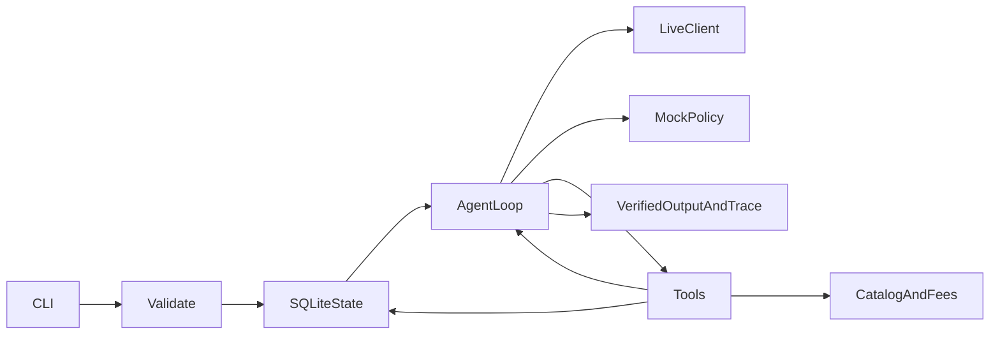

# 技术方案

Python 标准库负责 CLI、HTTP、时间、JSON 和 SQLite，pytest 用于测试，不引入复杂运行时。models 规范化输入，storage 事务与状态，tools 确定性业务，agent 循环与输出核验，llm_client 真实工具选择，mock_policy 独立离线策略。

工具返回 ok/data/error。estimate_cost(strategy) 计算前瞻预算/耗时并生成当前依赖计划；search_materials() 绑定输入主题检索；generate_script(strategy) 依赖成功检索和相同策略估算；save_plan() 复查预算、截止时间及脚本成功后原子保存。工具 schema 不允许模型传 budget/deadline 或任意执行代码。finish 仅表示模型结束，不是保存凭证。

每轮把模型工具动作执行后的观察作为 role=tool 回填，模型重新选择动作。Trace 的 next_action 来自下一次实际响应，只保留公开短理由，不保存隐藏推理或凭据。默认最多12轮/10工具，两次模型错误即 incomplete。mock 明确标记，不用于证明真实模型效果。

SQLite 三个主要表：jobs 绑定请求 SHA-256 指纹及执行模式，steps 按请求/逻辑步骤记录结果、错误、attempts、费用与模拟耗时，plans 对请求唯一。BEGIN IMMEDIATE 串行化收费工具与保存，缓存成功步骤不会重新扣费，失败步骤可重试；保存异常回滚。注入故障在执行前发生，费用和耗时为0。单库 demo 的原子性不扩展为真实远程服务 exactly-once 保证。

计划不要求模型一次写死全部执行路径：premium 估算12但预算10，模型可估算 basic8 后执行；有步骤失败时可以换策略、有限重试或停止。当前策略 task_plan 与历史 steps 分开显示，避免旧策略失败掩盖新策略成功，也避免抹掉成功素材和真实费用。新进程用同请求与DB即可恢复，无须再次执行已成功的检索。

所有费用为整数模拟单位，预计总费用=已发生账本+当前策略未成功步骤费用；已生成但后弃用的产物费用仍计入总账。时间统一从当前时刻投影剩余耗时：实时模式为当前UTC墙钟+剩余耗时，不再重复添加已完成步骤耗时；--now模拟模式先以固定起点+累计模拟耗时构造当前模拟时刻，再加剩余耗时。deadline 转UTC比较。每次收费工具和保存前重新计算，不能靠旧估算越过约束。

DeepSeek 使用 OpenAI 兼容 Chat Completions，显式关闭 thinking 支持 required 工具选择。真实服务错误经过凭据脱敏后保留诊断，HTTP超时45秒。成功结果由实际DB记录构造，而非模型自由文本。

结果核验保留原有status优先级，同时用blocking_reasons列出所有当前预算/时间缺口和当前计划失败步骤的结构化错误；未执行步骤和执行上限也有结构化条目。已弃用策略的失败留在历史steps中，不误列为成功替代方案的当前阻断。新字段来自服务端数据，不采信模型声明。Agent.run未调整。
